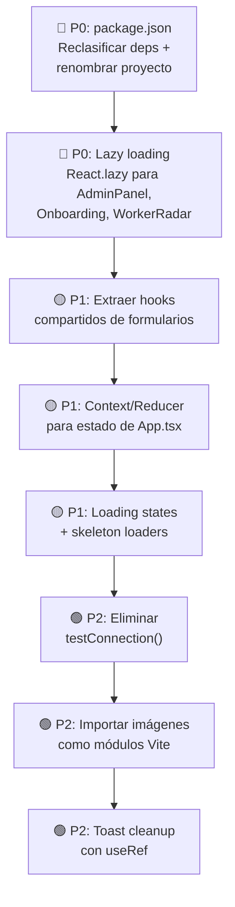

# 🔍 Auditoría Completa — LimpiaMX

> [!NOTE]
> Marketplace de servicios de limpieza en México. Stack: React 19 + TypeScript + Vite 8 + Firebase (Auth, Firestore, Storage) + Tailwind CSS 4 + Google Maps API + Recharts. ~12,000 líneas de código.

---

## Estado General

| Categoría | Estado | Notas |
|-----------|--------|-------|
| Compilación TypeScript | ⚠️ Pendiente | Conflictos de peer deps (esbuild) resueltos con `--legacy-peer-deps` |
| Arquitectura | 🟡 Funcional pero mejorable | App.tsx monolítico (938 líneas) con ~25 estados |
| Seguridad Firestore | 🟢 Sólida | Reglas hardened con validación completa de esquemas |
| Seguridad Storage | 🟡 Aceptable | Lectura pública — riesgo menor por diseño |
| UX/Accesibilidad | 🟢 Buena | ARIA labels, roles correctos, focus management |
| Rendimiento | 🟡 Mejorable | Re-renders innecesarios, sin lazy loading |

---

## 🔴 Problemas Críticos

### 1. `package.json` — Nombre genérico y dependencias mal clasificadas
- **Nombre**: `"react-example"` → debería ser `"limpiamx"`
- **Dev dependencies en dependencies**: `eslint`, `@types/*`, `dotenv`, `express`, `esbuild`, `tsx`, `autoprefixer` están en `dependencies` cuando deberían estar en `devDependencies`
- **Conflicto peer deps**: `@vitejs/plugin-react` requiere `esbuild ^0.25` pero `vite@8.3` quiere `^0.27 || ^0.28`

### 2. `App.tsx` — Componente monolítico (938 líneas)
- **25+ estados** en un solo componente `MarketplaceContent`
- Sin React Context ni estado global → prop drilling masivo
- Toda la lógica de suscripción Firestore está inline en `useEffect`
- Falta `React.memo` en componentes hijos

### 3. Email de Super Admin hardcodeado en frontend
```typescript
// types/marketplace.ts
export const SUPER_ADMIN_EMAIL = 'villaralan11@gmail.com';
```
- Expuesto en el bundle de producción
- Debería usarse solo en Firestore rules (donde ya está) y validarse por Custom Claims

### 4. Falta protección de rutas (no-auth guard)
- La sección `base-datos` (admin panel) se muestra solo con `isAdmin && user`, pero la verificación se hace en cliente — alguien puede manipular el estado de React

---

## 🟡 Problemas Importantes

### 5. Sin lazy loading de componentes
Los 16 componentes se importan estáticamente en [App.tsx](file:///home/alancito/antigravity/LimpiaMX/src/App.tsx#L40-L52). Componentes pesados como `AdminPanelView` (1694 líneas), `OnboardingWizard` (1176 líneas), y `WorkerRadarMap` (819 líneas) deberían cargarse con `React.lazy()`.

### 6. `useEffect` con dependencias inconsistentes
En [CleanerDetailModal.tsx](file:///home/alancito/antigravity/LimpiaMX/src/components/CleanerDetailModal.tsx#L114-L120):
```tsx
useEffect(() => {
  if (eligibleBookingsForReview.length > 0) {
    setSelectedBookingId(eligibleBookingsForReview[0].id);
  }
}, [eligibleBookingsForReview.length, cleaner?.id]);
// ❌ Depende de .length pero accede a [0].id — puede desyncharse
```

En [OnboardingWizard.tsx](file:///home/alancito/antigravity/LimpiaMX/src/components/OnboardingWizard.tsx#L114-L138):
```tsx
useEffect(() => {
  // ... setters de 10+ campos
}, [existingProfile, proBio]);
// ❌ proBio en deps causa re-sync infinito si se edita
```

### 7. Seed service escribe desde el cliente (no desde admin SDK)
[seedDemoService.ts](file:///home/alancito/antigravity/LimpiaMX/src/lib/seedDemoService.ts) usa `writeBatch` desde el cliente para crear 100+ documentos. Los Firestore rules ya permiten solo admin, pero es más eficiente y seguro hacer esto con Cloud Functions.

### 8. `testConnection()` en firebase.ts se ejecuta en cada import
```typescript
// firebase.ts línea 95
async function testConnection() { ... }
testConnection(); // ← side effect en módulo raíz
```
Lee un doc `test/connection` que probablemente no existe, genera errores silenciosos en consola.

### 9. `HERO_IMAGE_URL` y `PORTRAIT_PRESETS` usan rutas `/src/assets/`
```typescript
export const HERO_IMAGE_URL = '/src/assets/images/hero_mexican_living_room_1795321033270.jpg';
```
Funciona gracias al plugin Vite `copy-unbundled-src-assets`, pero es un patrón frágil. Deberían importarse como módulos Vite (`import heroImg from './assets/...'`).

### 10. No hay manejo de errores en suscripciones Firestore
En [App.tsx](file:///home/alancito/antigravity/LimpiaMX/src/App.tsx), las suscripciones (`subscribeActiveCleaners`, etc.) usan `handleFirestoreError` que hace `throw` — pero los errores en listeners de `onSnapshot` pueden crashear la app silenciosamente.

---

## 🟢 Mejoras de Calidad

### 11. Duplicación de lógica de formularios
`ProfileView.tsx`, `OnboardingWizard.tsx`, y `PublishAdView.tsx` tienen **código casi idéntico** para:
- Upload de avatar/portfolio
- Toggle de servicios
- Validación de colonias
- Parseo de colonias separadas por coma

→ Extraer hooks compartidos: `useAvatarUpload`, `useServiceToggle`, `useColoniaParsing`

### 12. Sin loading states globales
No hay skeleton loaders ni spinners durante la carga inicial de Firestore. El usuario ve contenido vacío hasta que las suscripciones responden.

### 13. Toast con `setTimeout` sin cleanup
```tsx
// App.tsx
const showToast = (msg: string) => {
  setToastMessage(msg);
  setTimeout(() => setToastMessage(''), 4000);
  // ❌ No limpia el timer si el componente se desmonta
};
```

### 14. `coloniasMx.ts` — sin verificación del tamaño del bundle
El archivo de datos de colonias se importa estáticamente. Si es grande, incrementa el bundle initial significativamente. Debería ser lazy o cargarse con un dynamic import.

### 15. CSV export — falta sanitización completa
[csvExport.ts](file:///home/alancito/antigravity/LimpiaMX/src/lib/csvExport.ts#L9-L11) ya maneja fórmula injection (`=`, `+`, `-`, `@`), pero le falta proteger contra `\t` y `\r` incrustados en campos de texto.

### 16. `storage.rules` — lectura pública sin restricción
```
allow read: if true;
```
Cualquier persona puede leer las imágenes subidas por usuarios. Para un marketplace es aceptable, pero considera restringir a usuarios autenticados.

---

## 📊 Prioridades de Acción



---

## ✅ Cosas Bien Hechas

- **Firestore rules**: Exhaustivas y bien diseñadas — validación de esquema completa, RBAC con super admin + delegated admin, audit log inmutable, booking state machine correcta
- **Validación sincronizada**: `VALIDATION_LIMITS` compartidas entre frontend y rules
- **Accesibilidad**: Labels HTML correctos, roles ARIA, aria-modal en modales
- **Tailwind CSS**: Diseño consistente con palette teal/slate, responsive bien implementado
- **Google Maps**: Quota defense con cache en sessionStorage, batch geocoding, marker spreading
- **CSV Export**: BOM UTF-8 para Excel, protección contra formula injection
- **Tipos TypeScript**: Tipado fuerte para todas las entidades del dominio
- **Patrón de mapeo**: `mapUserProfile()`, `mapCleanerDoc()` etc. con defaults seguros
